### Glug glug glug °‧ 𓆝 𓆟 𓆞 ·.

<picture>
  <source media="(prefers-color-scheme: dark)" srcset="assets/tank-dark.svg">
  
</picture>

  - Discord: @hyphensam
  - Matrix: @hyphensam:beeper.com
  - Signal: HyphenSam.01

```

                       /(  /:./\
                    ,_/:`-/::/::/\_ ,
                    |:|::/::/::/::;'( ,,
                    |:|:/::/::/:;'::,':(.( ,
                _,-'"HHHHH"""HHoo--.::::,-:(,----..._
            ,-"HHHb  "HHHHb  HHHHb   HHHoo-.::::::::::-.
          ,'   "HHHb  "HHHHb "HHHH   HHHHH  Hoo::::::::::.              _,.-::`.
        ,'      "HH`.  "HHHH  HHHHb  "HHHH  "HHHb`-:::::::.        _.-:::::::;'
       / ,-.        :   HHHH  "HHHH   HHHH   HHHH  Hoo::::;    _,-:::::::::;'
     ,'  `-'        :   HHHH   HHHH   "HHH   "HHH  "HHHH-:._,o:::::::::::;'
    /               :   HHHH __HHHP...........HHH   HHHF   HHH:::::::;:;'
   /_               ; _,-::::::.:::::::::::::''HH   HHH    "HH::::::::(
   (_"-.,          /  : :.::.:.::::::::::,d   HHH   "HH     HH::::::::::.
    (,-'          /    :.::.:::.::::::;'HHH   "HH    HH,::"-.H::::::::::::.
     ".         ,'    : :.:::.::::::;'  "HH    HH   _H-:::)   `-::::::::::::.
       `-.___,-'       `-.:::::,--'"     "H    HH,-::::::/        "--.::::::::.
            """---..__________________,-------'::::::::;/               """---'
                        \::.:---. fih      `::::::::::;'
                         \::::::|            `::;-'""
                          `.::::|
                            `.::| 
                              `-'
```

### 🦐 Feed the fish

The fish have been fed **<!--fed-->1<!--/fed-->** times. Last fed by <!--feeder-->[@HyphenSam](https://github.com/HyphenSam)<!--/feeder-->.

[**→ Drop in a shrimp**](https://github.com/HyphenSam/HyphenSam/issues/new?title=feed&body=%F0%9F%A6%90%20%28just%20press%20Create%2C%20the%20fish%20will%20do%20the%20rest%29)
